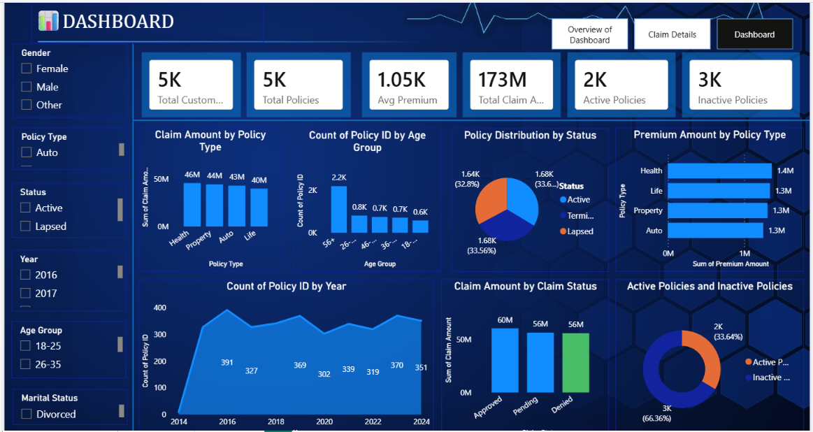

# 🛡️✨ Insurance Analytics | 🐬 SQL • 📗 Excel • 📊 Power BI 🚀


> 🚀✨ An end-to-end insurance analytics project: the same dataset is **validated and analyzed in MySQL** 🐬🧪, **summarized in an Excel dashboard** 📗📈, and **visualized in a 3-page interactive Power BI report** 📊🎛️ to uncover business problems and recommend actions. 💡🔥

| 👥 Customers | 📄 Policies | 🧾 Business Questions | 📊 Dashboards |
|:---:|:---:|:---:|:---:|
| 🙋 **5,000** | 📑 **5,000** | ❓ **22** | 📗📊 **Excel + Power BI** |

---

## 🔗⚡ Quick Links

| 📌 Resource | 🌐 Link |
|---|---|
| 📗✨ Excel Dashboard | [📥 Insurance Dashboard.xlsx](Insurance%20Dashboard.xlsx) |
| 🐬🧪 SQL Analysis File | [📂 insurance_data_analsysis.sql](insurance_data_analsysis.sql) |
| 📊🔥 Power BI File | [📥 Insurance Analysis.pbix](Insurance%20Analysis.pbix) |
| 🧭🗺️ Power BI: Overview Page | [🖼️ Overview of dashbord.png](https://github.com/rankhambeavantika-source/Insurance-analytics-dashboard/blob/main/Overview%20of%20dashbord.png) |
| ⚖️🧾 Power BI: Claims Analysis Page | [🖼️ Claims Anlsysis.png](https://github.com/rankhambeavantika-source/Insurance-analytics-dashboard/blob/main/Claims%20Anlsysis.png) |
| 💹🎯 Power BI: Dashboard Page | [🖼️ dashboard.png](https://github.com/rankhambeavantika-source/Insurance-analytics-dashboard/blob/main/dashboard.png) |

---

## 📑🧭 Table of Contents

| | | |
|---|---|---|
| 📌 [Project Overview](#-project-overview) | 🎯 [Objectives](#-project-objectives) | 🛠️ [Tools](#️-tools--technologies) |
| 🔄 [Workflow](#-end-to-end-workflow) | 📊 [Power BI Dashboard](#-power-bi-dashboard) | 📗 [Excel Dashboard](#-excel-dashboard) |
| 🧩 [Business Problems Solved](#-business-problems-solved) | ❓ [22 Business Questions](#-22-business-questions--answers) | 💡 [Key Insights](#-key-insights) |
| 🗂️ [Repo Structure](#️-repository-structure) | 🔮 [Future Work](#-future-improvements) | 👩‍💻 [Author](#-author) |

---

## 📌🏦 Project Overview

This project analyzes 🏦 insurance policy, customer, premium, and claims data to identify 📈 business trends, understand 📄 policy performance, and generate ✅ actionable insights. The workflow covers 🧹 **data validation, cleaning**, 🐬 **SQL analysis**, 📗 **an Excel dashboard**, and 📊 **a Power BI report**, all built for 💼 business reporting. 🎉

| 📌 Item | 📝 Details |
|---|---|
| 🏦 Domain | 🛡️ Insurance Analytics |
| 👥 Customers | 🙋‍♀️🙋‍♂️ 5,000 |
| 📄 Policies | 📑 5,000 |
| 🏷️ Policy Types | 🚗 Auto • 🏥 Health • ❤️ Life • 🏠 Property |
| 📅 Period | ⏳ 2014 – 2024 (policy and claim data) |
| 🔍 Focus Areas | 📋 Policy Status • 💰 Premium • 🧾 Claims • 👥 Demographics • 📈 Trends |
| 🖥️ Deliverables | 🐬 MySQL analysis • 📗 Excel dashboard • 📊 3-page Power BI dashboard |

---

## 🎯🏆 Project Objectives

- ✅🧹 Validate and clean insurance data
- ✅📋 Analyze policy status and distribution
- ✅💰 Evaluate premium and coverage amounts
- ✅👥 Explore customer demographics and age groups
- ✅🧾 Analyze claims by status, type, and year
- ✅📊 Build interactive dashboards in Excel and Power BI
- ✅💡 Convert analysis into business recommendations

---

## 🛠️⚙️ Tools & Technologies

| 🧰 Tool | 🎯 Purpose |
|---|---|
| 🐬 MySQL | 🧪 Data validation, cleaning checks, and SQL analysis 🔍 |
| 📗 Microsoft Excel | 📊 PivotTables, charts, KPIs, and interactive dashboard 🎛️ |
| 📊 Power BI | 🧱 Data modeling, 🧮 DAX measures, and multi-page interactive report 📑✨ |

---

## 🔄🚦 End-to-End Workflow

```
 📥 Raw Insurance Data
        ⬇️
 🧹 Data Validation & Cleaning (MySQL) 🐬
        ⬇️
 🔍 SQL Analysis (22 Business Questions) ❓
        ⬇️
 📗 Excel PivotTables & Dashboard 📈
        ⬇️
 📊 Power BI Model, DAX & Report 🧮
        ⬇️
 💡 Business Insights & Recommendations 🏆
```

---

## 📊🔥 Power BI Dashboard

The Power BI report has **3 interactive pages** 🎛️✨, each built for a different level of analysis. 🔎

### 1️⃣ Overview of Dashboard 🧭🗺️
A high-level view of policies, premiums, and claims. 👀

- 🎚️ Slicers: Policy Type 🏷️, Status 🚦, Year 📅
- 🔢 KPIs: Total Customers 👥, Total Policies 📄, Avg Premium 💵, Total Claim Amount 🧾, Active 🟢 and Inactive 🔴 Policies
- 👴 Count of policies by age group • 🥧 Policy distribution by status
- 💵 Premium by policy type • 🏥 Claim amount by policy type
- 📈 Policies by year • ✅ Claim amount by claim status

[](https://github.com/rankhambeavantika-source/Insurance-analytics-dashboard/blob/main/Overview%20of%20dashbord.png)

### 2️⃣ Claims Analysis ⚖️🧾
Detailed analysis of claim behavior. 🕵️

- 🎚️ Slicers: Claim Status ✅, Year and Quarter 📆, Settlement Year 🗓️
- 🔢 KPIs: Total Claims 🧾, Approval Rate % ✅, Avg Premium 💵, Total Claim Amount 💰, Avg Claim Amount 📌
- 📊 Claims by status • 🍩 Claim amount by policy type
- 📈 Monthly claim amount trend • 📅 Claim amount by settlement year
- 🍩 Claim status distribution

[](https://github.com/rankhambeavantika-source/Insurance-analytics-dashboard/blob/main/Claims%20Anlsysis.png)

### 3️⃣ Dashboard 💹🎯
Full summary page with the most filters. 🎛️

- 🎚️ Slicers: Gender 🚻, Policy Type 🏷️, Status 🚦, Year 📅, Age Group 🎂, Marital Status 💍
- 🔢 All key KPIs on one page 📌
- 🍩 Active 🟢 vs inactive 🔴 policies • 📈 Policy count by year
- 📊 Claim amount by policy type and by claim status

[](https://github.com/rankhambeavantika-source/Insurance-analytics-dashboard/blob/main/dashboard.png)

### 📈⭐ Power BI Highlights

| 📊 Metric | 🔢 Value |
|---|---|
| 💵 Avg Premium | 💲 1.05K |
| 🟢 Active Policies | ✅ 2K (33.64%) |
| 🔴 Inactive Policies | ❌ 3K (66.36%) |
| 👴 Largest Age Group | 🏅 56+ (2.2K policies) |
| 🏥 Highest Claim Amount | 🏆 Health (46M) |
| 💎 Highest Premium | 🥇 Health (1.4M) |
| 📈 Peak Policy Year | 🚀 2016 (391 policies) |
| ✅ Approval Rate | 📌 34.86% |
| 🧾 Avg Claim Amount | 💰 50.15K |

---

## 📗✨ Excel Dashboard

📥 Open the Excel file: [Insurance Dashboard.xlsx](Insurance%20Dashboard.xlsx)

**✨ Dashboard features**
- 🥧 Policy status distribution
- 👤 Customer and policy metrics
- 💵 Premium and coverage analysis
- 🎂 Customer age-group analysis
- 📅 Policy ending year trends
- 🖱️ Interactive slicers: Policy Type 🏷️, Status 🚦, Gender 🚻, Payment Mode 💳 (plus Active 🟢 / Inactive 🔴 and a 2014–2026 date calendar 🗓️)

### 🔢🏅 Excel KPI Cards

| 🏷️ KPI | 🔢 Value |
|---|---|
| 👥 Total Customers | 🙋 5,000 |
| 📄 Total Policies | 📑 5,000 |
| 💰 Claims Amount | 🧾 251.4 M |
| 💎 Avg. Coverage Amount | 🛡️ 254.56 K |
| 📉 Avg. Premium Growth Rate | 🔻 -12.48% |
| 🛡️ Average Premium Amount | 💵 1.05 K |

---

## 🧩🚨 Business Problems Solved

Each problem below was 🔎 identified from the data, analyzed with 🐬 SQL, 📗 Excel, or 📊 Power BI, and answered with a ✅ recommended action. 🎯

| # | 🚨 Business Problem | 🔎 What the Analysis Found | ✅ Recommended Action |
|:-:|---|---|---|
| 1️⃣ | ⚠️ **Low policy retention**: how many policies are really active? 🤔 | Only **33.64%** 🟢 are Active (1,682 of 5,000); **66.36%** 🔴 are Lapsed or Terminated 😟 | 🔔 Launch renewal reminders and early-warning alerts for at-risk customers 🚨 |
| 2️⃣ | 🔄 **Lapsed customers are being lost**: can they be won back? 🤝 | Active (1,682), Terminated (1,678), and Lapsed (1,640) are almost equal ⚖️, so the company loses about as many policies as it keeps 😬 | 🎯 Run win-back campaigns on the **1,640 lapsed policies** first 📣 |
| 3️⃣ | 📉 **Premium income is falling**: is growth healthy? 🩺 | Average premium growth is **-12.48%** 🔻; premium dropped from **562.43K (2022)** to **475.48K (2024)**, about a **15.5% fall** 📉 | 💰 Review pricing, product mix, and renewal terms 🔧 |
| 4️⃣ | 🏥 **Which product should be promoted?** 🏆 | **Health** 🏥 leads in policy count (1,316, 26.3%), premium (1.4M), and claim amount (46M); 🚗 **Auto** has the fewest policies (1,214, 24.3%) | 🤝 Cross-sell Health to Auto and Life customers; price Health claims carefully 🧮 |
| 5️⃣ | 🎂 **Who are the core customers?** 🎯 | Excel age bands: **28–37 (790)** and **58–67 (764)** lead 🥇🥈. Power BI age groups show **56+ (2.2K)** as the largest 👴 | 🎯 Offer Health/Life bundles to young professionals 👨‍💼👩‍💼 and retirement/health plans to seniors 👴👵 |
| 6️⃣ | ⏳ **Is claim handling too slow?** 🐌 | About **1 in 3 claims is still Pending** ⏳ (1.15K, 33.27%), with **56M** waiting 💸; only 34.86% are Approved ✅ | ⚡ Speed up claim processing and set service-time targets for pending claims 🏃 |
| 7️⃣ | 🧾 **Are claims too costly compared with premiums?** 💸 | Average claim is **50.15K** against an average premium of **1.05K**, about **48 times higher** 😮 | 🔍 Review claim-heavy segments and validate claim-to-premium data to protect profit 🛡️ |
| 8️⃣ | 📅 **When will renewals peak?** 🌋 | Policies ending peak at **526 in 2025** 📈; **2025–2027 covers 1,401 policies (~28%)** | 🗓️ Build a renewal strategy and team capacity plan before the peak window 👷 |
| 9️⃣ | 🚻 **Is gender a useful targeting factor?** 🤷 | Other (1,699), Male (1,677), and Female (1,624) are within about 75 policies of each other ⚖️ | 🎯 Keep marketing gender-neutral and target by **age and product** instead 🎂🏷️ |
| 🔟 | 📈 **How have policy sales changed over time?** ⏱️ | Policies rose sharply to **391 in 2016** 🚀, then stayed steady between about 300 and 370 per year 😐 | 🚀 Growth has flattened; look for new channels and products to restart it 🌱 |

---

## ❓🧠 22 Business Questions & Answers

### 🔢📌 A. KPI Questions

| # | ❓ Question | ✅ Answer |
|---|---|---|
| 1 | 📌 What are the headline KPIs of the portfolio? | 👥 5,000 customers • 📄 5,000 policies • 💰 251.4 M claims • 💎 254.56 K avg. coverage • 📉 -12.48% avg. premium growth • 🛡️ 1.05 K avg. premium |
| 2 | 👥 What is the total number of customers available in the policy database? | 🙋 5,000 customers |
| 3 | 📄 What is the total number of policies issued? | 📑 5,000 policies |
| 4 | 💰 What is the total claim amount generated from all policies? | 🧾 251.4 M |
| 5 | 💎 What is the average coverage amount per policy? | 🛡️ 254.56 K |
| 6 | 🛡️ What is the average premium amount collected per policy? | 💵 1.05 K |

### 📋🚦 B. Policy Status Questions

| # | ❓ Question | ✅ Answer |
|---|---|---|
| 7 | 🟢 What percentage of policies are currently active? | ✅ 33.64% (1,682 of 5,000) |
| 8 | 📊 How many policies are in active, lapsed, and terminated status? | 🟢 Active: 1,682 • 🔴 Terminated: 1,678 • 🟠 Lapsed: 1,640 |
| 9 | 🏆 Which policy status has the highest number of policies? | 🥇 Active (1,682), only just ahead of Terminated (1,678) 😮 |
| 10 | ⚖️ What is the ratio between active and inactive policies? | 🟢 Active 1,682 : 🔴 Inactive 3,318 (Lapsed + Terminated) ≈ 1 : 1.97 |

### 🎂👴 C. Age Group Questions

| # | ❓ Question | ✅ Answer |
|---|---|---|
| 11 | 👴 Which age group has the highest number of policies? | 🏆 28–37 with 790 policies |
| 12 | 🏅 Identify the top three age groups by policy count. | 🥇 28–37 (790) • 🥈 58–67 (764) • 🥉 38–47 (737) |

*📝 (Lowest: 78–87 with 570 policies.) 👵*

### 🚻👫 D. Gender Questions

| # | ❓ Question | ✅ Answer |
|---|---|---|
| 13 | 👥 Which gender has the highest policy participation? | 🥇 Other with 1,699 policies (34%), followed by 🥈 Male 1,677 and 🥉 Female 1,624 |
| 14 | ➗ What is the difference between male and female policy counts? | 👨 Male 1,677 − 👩 Female 1,624 = 53 policies (males are ahead) |

### 🏷️🏥 E. Policy Type Questions

| # | ❓ Question | ✅ Answer |
|---|---|---|
| 15 | 🏥 Which policy type has the maximum number of policies? | 🏆 Health with 1,316 policies (26.3%) |
| 16 | 🚗 Which policy type has the minimum number of policies? | 🔻 Auto with 1,214 policies (24.3%) |
| 17 | ⚔️ Compare Auto and Health policy counts. | 🏥 Health 1,316 vs 🚗 Auto 1,214, so Health leads by 102 policies (~8.4% higher) 📈 |
| 18 | ➕ What is the total number of policies across all policy types? | 🚗 1,214 + 🏥 1,316 + ❤️ 1,234 + 🏠 1,236 = 📑 5,000 |

### 📉💰 F. Premium Growth & Trend Questions

| # | ❓ Question | ✅ Answer |
|---|---|---|
| 19 | 📉 What is the average premium growth rate over all years? | 🔻 -12.48% |
| 20 | 📈 Is the premium growth trend increasing or decreasing over time? | Decreasing 🔻😟. Premium moves between ~510–562 K until 2022, then drops to 475.48 K in 2024 |
| 21 | ➖ What is the difference between the highest and lowest premium growth values? | 🔝 Highest 562.43 K (2022) − 🔻 Lowest 475.48 K (2024) = 86.95 K |
| 22 | 📅 What is the yearly trend of policies ending from 2016 to 2034? | 📈 Rises from 25 (2016) to a peak of 526 (2025), then declines every year to 33 (2034), a bell-shaped curve 🔔 |

---

## 💡🌟 Key Insights

- ⚠️🚨 **Only 1 in 3 policies is active.** Retention and renewal are the biggest business risk. 🔔
- ⚖️🟰 **The status split is nearly even.** Active, Terminated, and Lapsed are almost equal, so early-warning and win-back work on the 1,640 lapsed policies is a clear priority. 🎯📣
- 📉🔻 **Premium growth is declining.** Average premium fell about 15.5% from the 2022 peak to 2024, so pricing, product mix, and renewals need review. 💰🔧
- 🏥🏆 **Health is the strongest product.** It leads in policies, premium, and claim amount, which makes it the best cross-sell opportunity. 🤝💎
- 🎯🎂 **Older customers and young professionals drive the book.** Target 28–37 with Health/Life bundles and 56+ with retirement and health plans. 👴👨‍💼
- 👥🚻 **Gender is balanced.** Marketing can focus on age and product instead. 🏷️
- 📅🌋 **Renewal workload peaks around 2025.** About 28% of the book ends between 2025 and 2027. 🗓️👷
- 🧾🔍 **Claims need a closer look.** The average claim (50.15K) is far above the average premium (1.05K), and about a third of claims are still pending. ⏳💸

---

## 🗂️📦 Repository Structure

```
📦 Insurance-analytics-dashboard
 ┣ 📁 sql
 ┣ 📗 Insurance Dashboard.xlsx
 ┣ 📊 Insurance Analysis.pbix
 ┣ 🐬 insurance_data_analsysis.sql
 ┣ 🖼️ Overview of dashbord.png
 ┣ 🖼️ Claims Anlsysis.png
 ┣ 🖼️ dashboard.png
 ┗ 📄 README.md
```

---

## 🔍🐬 SQL Analysis

The SQL work includes:

- 🧪 Data validation
- ❓ Missing-value checks
- 🔁 Duplicate checks
- 📋 Policy status analysis
- 💰 Premium and coverage analysis
- 💡 22 business-focused questions

📂 Full SQL script: [insurance_data_analsysis.sql](insurance_data_analsysis.sql)

---

## 🚀💼 Business Value

This project shows how 🐬 **SQL**, 📗 **Excel**, and 📊 **Power BI** work together: SQL validates and analyzes the data 🔍, Excel summarizes key metrics 📈, and Power BI delivers interactive reporting that decision-makers can explore. 🎛️🏆

---

## 🔮🛣️ Future Improvements

- 🎨 Develop an interactive Tableau visualization
- 📊 Add claim ratio and loss ratio metrics
- 🔁 Add customer churn and retention analysis
- 🤖 Add forecasting for policies and claims
- 🌐 Publish the Power BI report to Power BI Service

---

## 👩‍💻💖 Author

**Avantika Rankhambe** 🌟

- 🔗 LinkedIn: [Avantika Rankhambe](https://www.linkedin.com/in/avantika-rankhambe-746808275)
- 🐙 GitHub: [rankhambeavantika-source](https://github.com/rankhambeavantika-source)
- 📧 Email: rankhambeavantika@gmail.com

⭐🌟 If you found this project useful, feel free to star the repository! 🌟⭐🙏💫
